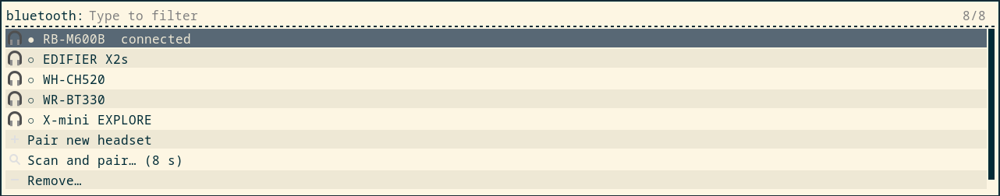

# btd

A small Bluetooth manager for Linux that replaces blueman and `bluetoothctl`.
It talks to BlueZ (`bluetoothd`) over D-Bus and to PipeWire natively, and is
built for an i3 desktop where audio devices matter most.


## Goals

- **Persistent connections**: reconnect trusted devices on startup, on resume
  and when the adapter powers on, retrying with backoff when a device refuses.
- **Audio follows the newest headset**: when an audio device connects, it
  becomes the default PipeWire sink and all playing streams move to it.
- **Audio first**: keep the A2DP profile active (AAC where available).
- **No legacy**: no HSP, no OBEX/file transfer.

## Components

One binary, three roles:

- `btd daemon`: systemd user service. Handles reconnects, audio switching and
  the BlueZ pairing agent (Just Works pairing is accepted only while a pairing
  window opened by `btd pair` is active).
- `btd <command>`: CLI with `list`, `scan`, `pair`, `connect`, `disconnect`
  and `remove`. Pairing also trusts the device.
- `btd menu`: rofi script-mode picker, meant to be bound to a key.

## Stack

- Rust, edition 2024
- [zbus](https://crates.io/crates/zbus) for BlueZ and desktop notifications
- [zlink](https://crates.io/crates/zlink) for the Varlink API between the CLI
  and the daemon (`com.theorycorner.Btd`)
- [pipewire](https://crates.io/crates/pipewire) for watching nodes and setting
  the default sink through WirePlumber metadata
- tokio, clap, tracing (journald output)

`bluetoothd` itself is not replaced.

## Status

Prototype. Working: the daemon, `list`, `connect`, `disconnect`, `scan`,
`pair`, `remove`, the pairing agent, auto-reconnect of the last used audio
device, audio switching, and the rofi menu.

## Anti-features and limitations

### Anti-features

Things btd deliberately doesn't do, and won't:

- **No tray icon or GUI window.** The interface is the CLI and the rofi menu.
- **No pairing outside `btd pair`.** Nothing can pair with the computer unless
  you just asked for it.
- **No PIN or passkey pairing.** Just Works only, so keyboards that insist on a
  typed passkey can't be paired.
- **No reconnecting every known device.** Only the last used audio device is
  reconnected.
- **No restoring the previous output.** The newest headset wins; when it
  disconnects, PipeWire picks the fallback.
- **No network access.** No cloud name lookups, telemetry or update checks.
- **No legacy profiles.** No HSP, OBEX file transfer, Bluetooth networking (PAN)
  or serial ports.
- **No replacing `bluetoothd`.** BlueZ does the Bluetooth work; btd is policy on
  top of it.

### Limitations

Things btd doesn't do yet:

- No config file; the defaults are fixed for now.
- Only the first Bluetooth adapter is used.
- No LE Audio (LC3, Auracast).
- Only tested on Arch/Manjaro with PipeWire and WirePlumber.

## Install on Arch Linux

btd is not on the AUR yet. The repository has two PKGBUILDs, so pacman
still tracks and can cleanly remove everything it installs:

- `contrib/arch/btd-bluetooth-bin`: the prebuilt x86_64 binary from the
  latest GitHub release. No Rust toolchain needed.
- `contrib/arch/btd-bluetooth-git`: builds the latest commit from source.

Both install `/usr/bin/btd`, so they conflict with the unrelated AUR package
`btd` (a btrfs disk usage tool).

1. Start BlueZ:

   ```sh
   sudo pacman -S --needed bluez
   sudo systemctl enable --now bluetooth.service
   ```

2. Remove other Bluetooth managers. btd registers itself as BlueZ's pairing
   agent and handles reconnects and audio switching, so blueman or a desktop
   environment's Bluetooth applet would fight it:

   ```sh
   sudo pacman -Rs blueman
   ```

   Also remove any `blueman-applet` line from your window manager's startup
   config.

3. Build and install the package, either the prebuilt binary:

   ```sh
   git clone https://github.com/HallowDance/btd.git
   cd btd/contrib/arch/btd-bluetooth-bin
   makepkg -si
   ```

   or from source (pulls in `cargo` and `clang` as build dependencies):

   ```sh
   cd btd/contrib/arch/btd-bluetooth-git
   makepkg -si
   ```

4. Start the daemon for your user:

   ```sh
   systemctl --user enable --now btd.service
   ```

5. Check that it runs:

   ```sh
   btd list
   journalctl --user -u btd -n 5
   ```

   The log should show `pairing agent registered` and `listening on ...`.

To update, `git pull` and run `makepkg -si` again, then
`systemctl --user restart btd`.

### Without a package

Needs Rust 1.88 or newer, `clang` and `pkgconf`:

```sh
cargo install --path .
mkdir -p ~/.config/systemd/user
sed 's|/usr/bin/btd|%h/.cargo/bin/btd|' contrib/btd.service \
    > ~/.config/systemd/user/btd.service
systemctl --user daemon-reload
systemctl --user enable --now btd.service
```

## Usage

```sh
btd list                 # numbered list of known devices and their state
btd connect 2            # by number from `btd list`
btd connect rb-m600      # or by name substring or address
btd disconnect           # the only connected device; errors if none or several
btd disconnect rb-m600   # also stops auto-reconnect until the next connect
btd scan                 # show nearby devices live for 15 s (-s to change)
btd scan --all           # also devices that don't broadcast a name
btd pair                 # pair, trust and connect the one headset in pairing mode
btd pair 9               # or a device from `btd scan`
btd remove 3             # unpair and forget
journalctl --user -u btd -f
```

Pairing is Just Works only (no PIN or passkey). The daemon is BlueZ's
default pairing agent and accepts requests only while `btd pair` is running,
so nothing can pair with this computer otherwise. `btd pair` without a device
only picks headsets and headphones, so always-visible speakers and TV boxes
nearby don't get in the way.

Like Android, `btd scan` and `btd list` hide devices that don't broadcast a
name (mostly phones, watches and trackers with rotating addresses). `--all`
shows them as `(no name)`.

The daemon remembers the last connected audio device in
`~/.local/state/btd/last-audio-device` and reconnects it when it drops, with
backoff from 15 s up to 10 min. It only does this while no other audio device
is connected.

### rofi menu

Bind it to a key, e.g. in sxhkd:

```
super + x
        rofi -show btd -modi "btd:btd menu" -show-icons
```



Shows paired devices (● connected, ○ not); Enter toggles the connection.
Also has "Pair new headset", "Scan and pair…" and "Remove…". Connecting and
pairing run in the background and report through desktop notifications, so
the menu closes right away.

Any command takes `--notify` to report that way instead of printing, which
suits key bindings, e.g. `btd --notify disconnect`.

### Varlink API

The Varlink API is on `$XDG_RUNTIME_DIR/btd.sock`:

```sh
varlinkctl introspect $XDG_RUNTIME_DIR/btd.sock com.theorycorner.Btd
```

## Credits

Written by Ivo Iliev with Claude (Anthropic's Claude Opus 5.5) via Claude Code.

## License

GPL-3.0-or-later. See [LICENSE](LICENSE).
